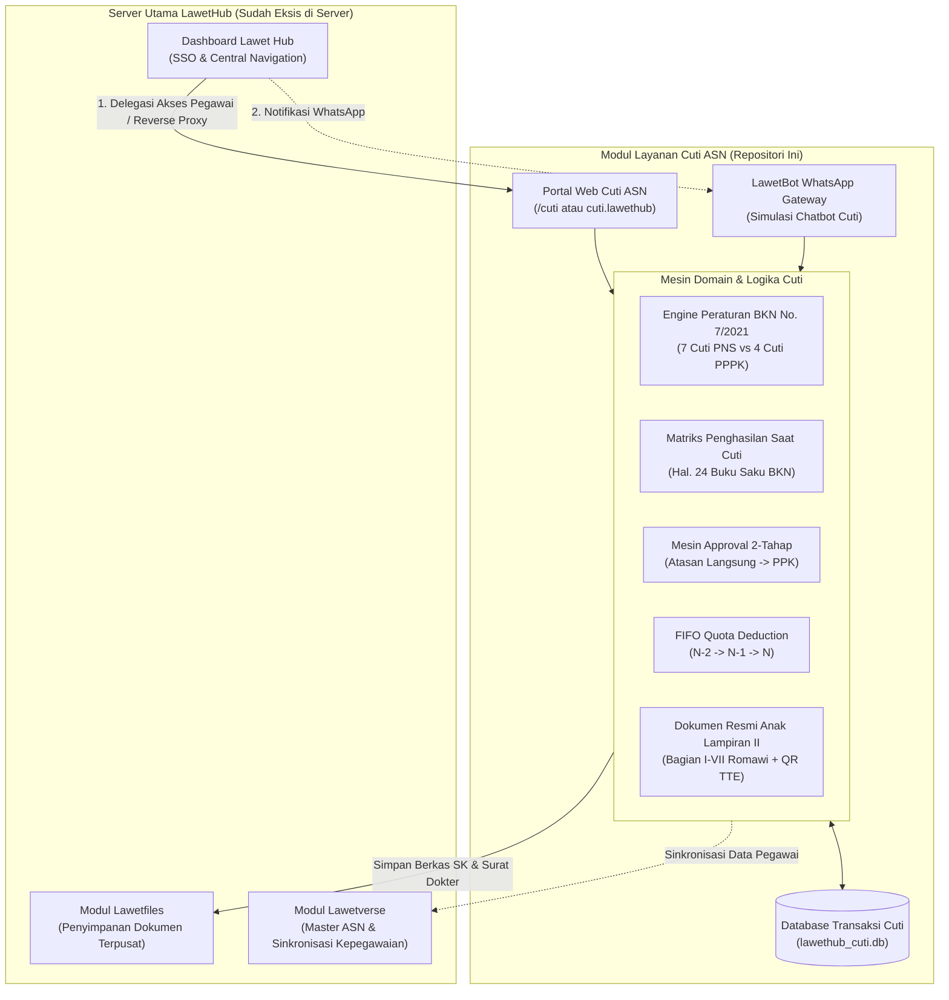
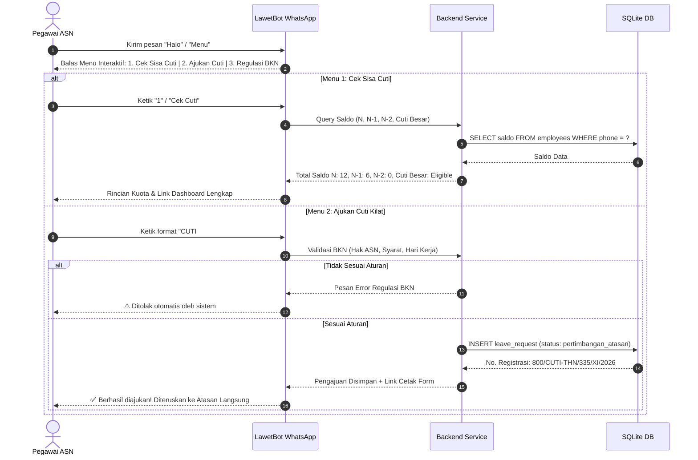
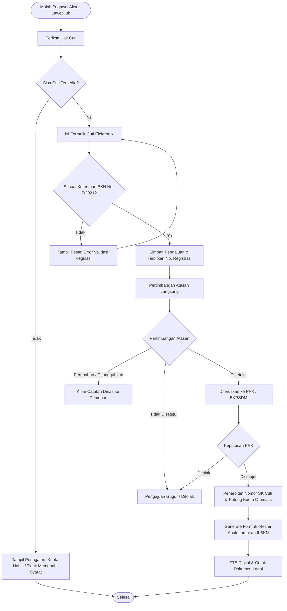

# Modul Layanan Cuti ASN — LawetHub Kebumen
### Sub-sistem Terintegrasi untuk Core LawetHub • Berdasarkan Peraturan BKN Nomor 7 Tahun 2021

[](https://react.dev/)
[](https://vitejs.dev/)
[](https://tailwindcss.com/)
[](https://nodejs.org/)
[](https://nodejs.org/api/sqlite.html)
[](https://bkn.go.id)

---

> [!IMPORTANT]
> **Batasan Lingkup & Penyelarasan Sistem (System Boundary):**
> Server utama **LawetHub** (*Centralized Civil Servant Super-App* Kabupaten Kebumen yang mengelola SSO, Lawetfiles, Lawetree, dan Lawetverse) sudah aktif di server Pemkab. Repositori ini khusus membangun **Modul Layanan Cuti ASN** (*Leave Management Sub-system / Pluggable Microservice*) yang dipanggil langsung dari node **`Dashboard Lawet Hub` &rarr; `Menu Layanan Cuti`** sebagaimana dimodelkan pada `Sistem Informasi Layanan Cuti.drawio` Halaman 2.

---

## 📌 Ringkasan Eksekutif

**Modul Layanan Cuti ASN LawetHub** adalah sub-sistem digital mandiri terpadu untuk pengajuan, validasi kepatuhan, verifikasi berjenjang, dan penerbitan izin cuti bagi **Pegawai Negeri Sipil (PNS)** dan **Pegawai Pemerintah dengan Perjanjian Kerja (PPPK)** di lingkungan Pemerintah Kabupaten Kebumen.

Sistem dirancang mengacu pada:
1. **Peraturan Badan Kepegawaian Negara (BKN) Nomor 7 Tahun 2021** tentang Tata Cara Pemberian Cuti PNS.
2. **Buku Saku FAQ Cuti PNS & PPPK BKN 2024** (Matriks Penghasilan Saat Cuti, Aturan Cuti Besar, dan Batas Hak PPPK).
3. **Arsitektur Alur Kerja Drawio** (`Sistem Informasi Layanan Cuti.drawio`):
   - **Diagram 1**: Alur Chatbot WhatsApp Mandiri (*LawetBot WA*).
   - **Diagram 2**: Alur Portal Web Resmi (Pemeriksaan Hak &rarr; Validasi Regulasi &rarr; Pertimbangan Atasan &rarr; Keputusan PPK &rarr; Ekspor Lampiran II).
4. **ADR-0005 LawetHub Ecosystem**: Integrasi alur persetujuan lintas aplikasi, penyimpanan dokumen terpusat (*Lawetfiles*), dan sinkronisasi data pegawai (*Lawetverse*).
5. **UI/UX Pinterest Leave Management Design**: Layout dashboard *dual-card* modern (*Monthly Dayoff Tracker* & *Annual Leave Two Part Selection*) dengan visualisasi kalender coral, badge status dinamis, dan zero dead space.

---

## 🏛️ Arsitektur Hub-and-Spoke (Relasi Host LawetHub & Modul Cuti)


    SALARY_CALC --> WORKFLOW_ENGINE
    WORKFLOW_ENGINE --> TAHAP1 --> TAHAP2 --> TAHAP3 --> TAHAP4
    WORKFLOW_ENGINE <--> DB
    TAHAP1 --> DOCS
```

---

## 🔄 Alur Proses 1: WhatsApp Chatbot (*LawetBot WA*)

Mengacu pada **Diagram 1 Drawio**, pegawai dapat mengakses layanan cepat tanpa harus membuka komputer kantor:



---

## 📋 Alur Proses 2: Web Portal Resmi (*Approval & Output Lampiran II*)

Mengacu pada **Diagram 2 Drawio**:



---

## ⚖️ Matriks Regulasi Peraturan BKN No. 7 Tahun 2021

Sistem menanamkan (*hardcoded rule invariants*) domain regulasi resmi:

### 1. Komparasi Hak Cuti PNS vs PPPK (Hal. 4 Buku Saku)
| Jenis Cuti | PNS | PPPK | Ketentuan Khusus |
| :--- | :---: | :---: | :--- |
| **Cuti Tahunan** | ✅ 12 hari/thn | ✅ 12 hari/thn | Wajib bekerja min. 1 tahun terus-menerus. Carryover N-1 maksimal 6 hari kerja. |
| **Cuti Sakit** | ✅ s.d. 1,5 tahun | ✅ Sesuai SKD | >1 hari wajib melampirkan Surat Keterangan Dokter berizin resmi. Keguguran max 45 hari. |
| **Cuti Melahirkan** | ✅ 3 bulan | ✅ 3 bulan | Diberikan untuk anak ke-1 sampai ke-3. Kelahiran anak ke-4+ bagi PNS beralih menjadi Cuti Besar. |
| **Cuti Bersama** | ✅ Ya | ✅ Ya | Ditetapkan Presiden; **tidak memotong** jatah cuti tahunan pegawai. |
| **Cuti Besar** | ✅ s.d. 3 bulan | ❌ Tidak Berhak | Masa kerja min. 5 tahun terus menerus. Dikecualikan untuk ibadah haji pertama & anak ke-4+. |
| **Cuti Alasan Penting** | ✅ s.d. 1 bulan | ❌ Tidak Berhak | Keluarga inti sakit keras/meninggal, melangsungkan perkawinan, istri melahirkan/caesar, bencana. |
| **Cuti di Luar Tanggungan Negara** | ✅ s.d. 3+1 thn | ❌ Tidak Berhak | Masa kerja min. 5 tahun. Diberhentikan sementara dari jabatan, penghasilan dinonaktifkan (Rp 0). |

### 2. Matriks Penghasilan Saat Cuti (Hal. 24 Buku Saku)
| Jenis Cuti ASN | Gaji Pokok | Tunj. Keluarga | Tunj. Pangan | Tunj. Jabatan | TPP Instansi |
| :--- | :---: | :---: | :---: | :---: | :---: |
| **Cuti Tahunan** | ✅ 100% | ✅ 100% | ✅ 100% | ✅ 100% | ✅ 100% |
| **Cuti Besar** | ✅ 100% | ✅ 100% | ✅ 100% | ❌ **0% (Ditiadakan)** | Kebijakan OPD |
| **Cuti Sakit** | ✅ 100% | ✅ 100% | ✅ 100% | ✅ 100% | Sesuai Durasi |
| **Cuti Melahirkan** | ✅ 100% | ✅ 100% | ✅ 100% | ✅ 100% | ✅ 100% |
| **Cuti Alasan Penting** | ✅ 100% | ✅ 100% | ✅ 100% | ✅ 100% | ✅ 100% |
| **Cuti Bersama** | ✅ 100% | ✅ 100% | ✅ 100% | ✅ 100% | ✅ 100% |
| **CLTN** | ❌ **Rp 0** | ❌ **Rp 0** | ❌ **Rp 0** | ❌ **Rp 0** | ❌ **Rp 0** |

---

## 🎨 Desain Antarmuka: Pinterest Leave Management Showcase

Dashboard mengimplementasikan referensi visual Pinterest Leave Management:
1. **MONTLY DAYOFF Tracker Card**:
   - Pemilih bulan dinamis dengan kontrol `<` `>`.
   - Filter mode `single` / `multiple`.
   - Kalender visual dengan pin merah *coral* solid pada tanggal cuti (15 & 30) serta titik indikator status.
   - List badge berjadwal: `4 Double DaysOff` (badge biru langit), `5 Single DayOff` (badge amber), `DY International Layover` (badge amber).
   - *Floating Action Button (FAB)* coral dengan ikon pesawat kertas (`Send`) untuk mengajukan cuti cepat.
2. **ANNUAL LEAVE Two Part Selection Card**:
   - Header *Annual Leave* aksen coral dengan selector tahun.
   - Total kuota tahunan dinamis terintegrasi ke saldo ASN.
   - Kartu periode *Winter* (Semester I) dan *Summer* (Semester II) dengan limit `Period Value` dan `Max Request: 6`.
   - Akordeon riwayat permohonan (*My Requests*) dengan pill status persetujuan.
3. **Widescreen Fluid Layout**:
   - Mengeliminasi whitespace berlebih dengan layout tepi-ke-tepi (`w-full px-4 sm:px-8 lg:px-12 xl:px-16`).
   - Panel Status ASN interaktif 2-kolom pada halaman Beranda.

---

## 🗄️ Skema Database (SQLite)

```sql
-- 1. Master Pegawai (PNS & PPPK)
CREATE TABLE employees (
  id TEXT PRIMARY KEY,
  nip TEXT UNIQUE NOT NULL,
  nama TEXT NOT NULL,
  email TEXT,
  no_hp TEXT,
  password TEXT DEFAULT '123456',
  role TEXT NOT NULL, -- 'pegawai', 'atasan', 'ppk', 'admin'
  jenis_asn TEXT NOT NULL, -- 'PNS', 'PPPK'
  jabatan TEXT NOT NULL,
  pangkat_golongan TEXT,
  unit_kerja TEXT NOT NULL,
  instansi TEXT NOT NULL DEFAULT 'Pemerintah Kabupaten Kebumen',
  tmt_cpns TEXT NOT NULL,
  masa_kerja_tahun INTEGER NOT NULL,
  masa_kerja_bulan INTEGER NOT NULL,
  avatar TEXT,
  sisa_cuti_n2 INTEGER DEFAULT 0,
  sisa_cuti_n1 INTEGER DEFAULT 6,
  sisa_cuti_n INTEGER DEFAULT 12,
  cuti_besar_terakhir TEXT,
  cuti_sakit_terpakai INTEGER DEFAULT 0,
  jumlah_anak_lahir INTEGER DEFAULT 2,
  is_active INTEGER DEFAULT 1,
  atasan_id TEXT,
  created_at TEXT DEFAULT CURRENT_TIMESTAMP
);

-- 2. Transaksi Pengajuan & Approval Cuti
CREATE TABLE leave_requests (
  id TEXT PRIMARY KEY,
  nomor_surat TEXT UNIQUE,
  employee_id TEXT NOT NULL,
  jenis_cuti TEXT NOT NULL, 
  alasan_cuti TEXT NOT NULL,
  kategori_detail TEXT, 
  anak_ke INTEGER,
  tanggal_mulai TEXT NOT NULL,
  tanggal_selesai TEXT NOT NULL,
  jumlah_hari INTEGER NOT NULL,
  alamat_selama_cuti TEXT NOT NULL,
  no_telepon_cuti TEXT NOT NULL,
  lampiran_nama TEXT,
  lampiran_url TEXT,
  status TEXT DEFAULT 'diajukan', -- 'diajukan', 'pertimbangan_atasan', 'disetujui', 'perubahan', 'ditangguhkan', 'ditolak'
  atasan_id TEXT,
  atasan_aksi TEXT, -- 'DISETUJUI', 'PERUBAHAN', 'DITANGGUHKAN', 'TIDAK_DISETUJUI'
  atasan_catatan TEXT,
  atasan_tanggal TEXT,
  ppk_id TEXT,
  ppk_aksi TEXT, 
  ppk_catatan TEXT,
  ppk_tanggal TEXT,
  nomor_sk TEXT,
  created_at TEXT DEFAULT CURRENT_TIMESTAMP,
  updated_at TEXT DEFAULT CURRENT_TIMESTAMP,
  FOREIGN KEY (employee_id) REFERENCES employees(id)
);

-- 3. Kalender Hari Libur Nasional & Cuti Bersama
CREATE TABLE public_holidays (
  id TEXT PRIMARY KEY,
  tanggal TEXT UNIQUE NOT NULL,
  nama_libur TEXT NOT NULL,
  kategori TEXT NOT NULL -- 'nasional', 'cuti_bersama'
);

-- 4. Log Percakapan Chatbot WhatsApp
CREATE TABLE chat_logs (
  id INTEGER PRIMARY KEY AUTOINCREMENT,
  phone TEXT NOT NULL,
  employee_id TEXT,
  sender TEXT NOT NULL, -- 'user', 'bot'
  message TEXT NOT NULL,
  timestamp TEXT DEFAULT CURRENT_TIMESTAMP
);
```

---

## 🚀 Panduan Menjalankan Sistem (Quickstart)

### Prasyarat
- **Node.js**: v20.x atau v24.x (disarankan v24.x dengan dukungan SQLite bawaan `node:sqlite`).
- **NPM**: v10.x ke atas.

### Langkah Instalasi
```bash
# 1. Clone repository
git clone https://github.com/MohammadNasrullohh/lawethub-layanan-cuti.git
cd lawethub-layanan-cuti

# 2. Install dependencies
npm install

# 3. Build bundle frontend
npm run build

# 4. Jalankan server backend & frontend production
npm start
```
Buka browser di **`http://localhost:3001`**.

---

## 👥 Akun Simulasi & Akses Multi-Role

Sistem dilengkapi tombol *1-Click Demo Switcher* di pojok kanan atas untuk menguji alur secara instan tanpa perlu logout-login manual:

| Nama Pegawai | NIP | Jenis ASN | Role Akses | Jabatan & SKPD |
| :--- | :--- | :---: | :---: | :--- |
| **Anindya Putri, S.Kom.** | 199504122020122008 | **PNS** | `pegawai` | Pranata Komputer Ahli Pertama (Diskominfo) |
| **Rian Hidayat, S.Pd.** | 199308152023211004 | **PPPK** | `pegawai` | Ahli Pertama - Guru TIK (Disdikpora) |
| **Bambang Trianto, S.T., M.Eng.** | 198205102008011005 | **PNS** | `atasan` | Kepala Bidang Aplikasi Informatika (Diskominfo) |
| **Drs. H. Ahmad Fauzi, M.Si.** | 197003141994031002 | **PNS** | `ppk` | Kepala BKPSDM (Pejabat Pembina Kepegawaian) |
| **Siti Aminah, S.Sos.** | 198901232014022001 | **PNS** | `admin` | Analis SDM Aparatur (BKPSDM) |

*Password standar demo:* `123456`

---

## 📄 Struktur Folder Proyek

```
c:/2026/cuti/
├── dist/                          # Production build Vite bundle
├── server/                        # Backend REST API & Engine
│   ├── bknRules.js                # Mesin validasi regulasi BKN No. 7/2021
│   ├── salaryMatrix.js            # Perhitungan matriks penghasilan saat cuti
│   ├── db.js                      # Inisialisasi skema & seed SQLite
│   ├── server.js                  # Express API, routing, chatbot WA, static server
│   └── lawethub_cuti.db           # SQLite persistent database file
├── src/                           # Frontend React 19 Application
│   ├── context/
│   │   └── AuthContext.jsx        # Manajemen sesi pegawai & role switcher
│   ├── components/
│   │   ├── Navbar.jsx             # Navigasi horizontal anti-wrap widescreen
│   │   ├── LandingPage.jsx        # Beranda 2-kolom dengan widget status ASN
│   │   ├── LoginPage.jsx          # Layar otentikasi NIP & password
│   │   ├── Dashboard.jsx          # Pinterest Dual-Card + AI Smart Advisor
│   │   ├── LeaveBalanceView.jsx   # Menu 1: Saldo N, N-1, N-2 & simulasi gaji
│   │   ├── LeaveApplicationForm.jsx# Menu 2: Form pengajuan & validasi BKN
│   │   ├── LeaveApprovalView.jsx  # Workflow approval Atasan & PPK
│   │   ├── LeaveExportPrint.jsx   # Dokumen resmi Anak Lampiran II BKN + QR Code
│   │   ├── CalendarView.jsx       # Kalender cuti bersama & agenda tim
│   │   ├── AdminRecapView.jsx     # Rekapitulasi BKPSDM + Ekspor CSV
│   │   ├── BknHandbookModal.jsx   # Pembaca digital Buku Saku FAQ BKN
│   │   └── WhatsAppChatbotDrawer.jsx # Drawer simulasi LawetBot WhatsApp
│   ├── App.jsx                    # Root view routing & container
│   ├── main.jsx                   # React DOM entrypoint
│   └── index.css                  # Tailwind CSS v4 styling & print rules
├── package.json                   # Dependency definitions
├── vite.config.js                 # Vite build & react plugin config
└── README.md                      # Dokumentasi komprehensif sistem
```

---

## ⚖️ Lisensi & Hak Cipta
Dikembangkan untuk Pemerintah Kabupaten Kebumen mengacu pada standar Badan Kepegawaian Negara Republik Indonesia. Seluruh hak cipta dilindungi undang-undang.
